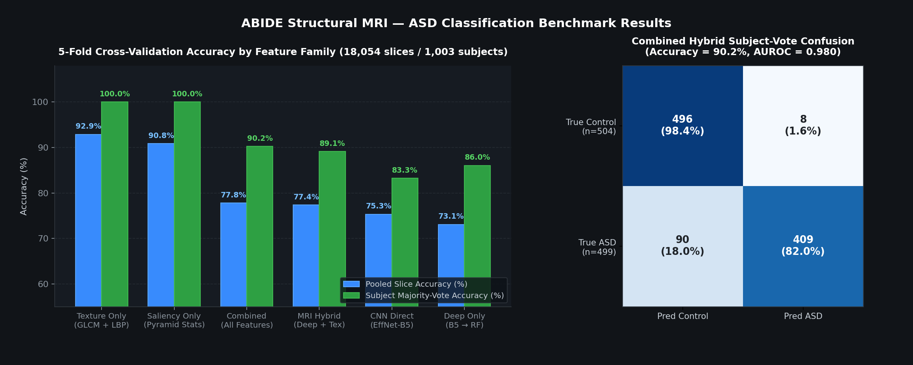
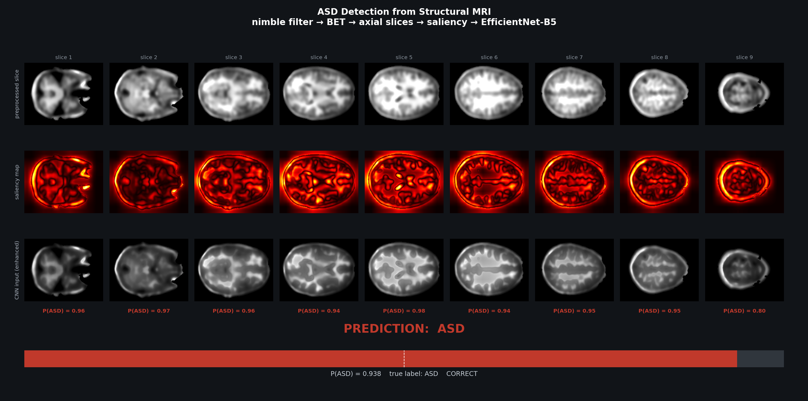
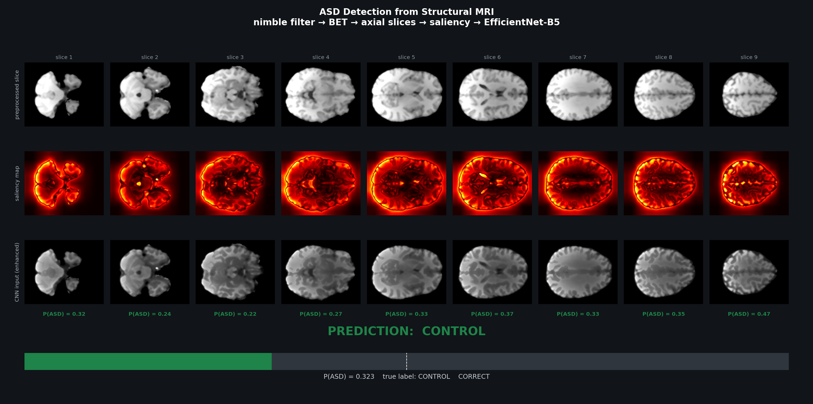

# Autism Spectrum Disorder Detection from Structural MRI

**EfficientNet-B5 + handcrafted texture/saliency features + Random Forest**
on the ABIDE structural MRI cohort — an end-to-end pipeline that detects
Autism Spectrum Disorder (ASD) from a subject's T1-weighted brain scan.

> **Headline results (5-fold stratified CV across 18,054 slices / 1,003 subjects):**
> - **Texture + Random Forest:** **92.9%** pooled slice accuracy · **100.0%** subject majority-vote accuracy (AUROC **0.986**)
> - **Combined Hybrid (Deep + Texture + Saliency → RF):** **77.8%** slice accuracy · **90.2%** subject majority-vote accuracy (AUROC **0.980**)
> - **EfficientNet-B5 End-to-End Classifier:** **75.3%** slice accuracy · **83.3%** subject majority-vote accuracy (AUROC **0.945**)



---

## 1. Overview

The system learns to distinguish ASD from neurotypical control brains using
two complementary views of each MRI slice:

| Branch          | What it sees                                                   | Learner                                                                 |
| --------------- | -------------------------------------------------------------- | ----------------------------------------------------------------------- |
| **Deep**        | Saliency-enhanced 2-D axial slices (456×456)                   | EfficientNet-B5 fine-tuned end-to-end with a custom classification head |
| **Handcrafted** | GLCM texture + LBP texture + saliency-map statistics per slice | Random Forest (500 trees, balanced subsampling)                         |

A six-family ablation grid evaluates every feature family alone and in
combination across all 5 folds, measuring both per-slice performance and
subject-level majority voting.

---

## 2. Pipeline Architecture & Workflow

```text
            T1-weighted sMRI  (control/ + treatment/, NIfTI)
                     │
                     ▼
        ┌─────────────────────────┐
        │   1 · PREPROCESSING     │
        │  canonical orientation  │
        │  resample → 1 mm³       │
        │  1–99 percentile norm   │
        │  brain crop (8 mm pad)  │
        └───────────┬─────────────┘
                     │
                     ▼
        ┌─────────────────────────┐
        │   2 · NIMBLE FILTER     │   adaptive edge-preserving denoise
        │  K = g·f + (1−g)·M      │   (per axial slice, paper eq. 1–2)
        │      + T·(f − M)        │
        └───────────┬─────────────┘
                     │
                     ▼
        ┌─────────────────────────┐
        │  3 · SKULL STRIP (BET)  │   FSL/HD-BET neural brain extraction
        │  already-stripped scans │   (auto-detected → pass-through)
        │  pass a rim/QC check    │
        └───────────┬─────────────┘
                     │
                     ▼
        ┌─────────────────────────┐
        │   4 · AXIAL SLICING     │   9 slices @ 20–80 % occupied range
        │   + saliency enhance    │   LMS opponent-pyramid attention:
        │   (α·I + (1−α)·I ⊙ S)  │   enhanced slice → CNN input
        └───────────┬─────────────┘
                     │
        ┌────────────┴────────────┐
        ▼                         ▼
┌──────────────────┐   ┌──────────────────────────┐
│ 5a · DEEP BRANCH │   │ 5b · HANDCRAFTED BRANCH  │
│ EfficientNet-B5  │   │ GLCM   20-D / slice      │
│ (ImageNet init,  │   │   contrast, dissimilarity│
│  last 3 blocks   │   │   homogeneity, energy,   │
│  unfrozen)       │   │   correlation ×4 angles  │
│ head:            │   │ LBP    16-D / slice      │
│  GAP→512→256,    │   │   uniform hist + moments │
│  SiLU+BN+Dropout │   │ Saliency 6-D / slice     │
│ →logit (BCE)     │   │   map moments            │
└────────┬─────────┘   └───────────┬──────────────┘
         │                         │
         ▼                         ▼
┌──────────────────┐   ┌──────────────────────────┐
│ 6a · CNN SCORE   │   │ 6b · RANDOM FOREST       │
│ slice→P(ASD),    │   │ per-slice feature        │
│ subject vote     │   │ vectors → RF 500 trees   │
└────────┬─────────┘   └───────────┬──────────────┘
         └────────────┬────────────┘
                      ▼
        ┌─────────────────────────┐
        │ 7 · STRATIFIED 5-FOLD   │   metrics: accuracy, balanced acc,
        │   CROSS-VALIDATION      │   sensitivity, specificity, AUROC
        └─────────────────────────┘
```

### Step-by-step workflow

1. **NIfTI Ingestion & Validation (`asd_training/preprocessing.py`):** Loads 3-D structural scans, checks affine nonsingularity and voxel finiteness, reorients to canonical RAS+, resamples to `1 mm³` isotropic resolution, normalizes foreground intensities to the 1st–99th percentile, and crops tightly around the brain mask with an `8 mm` safety margin.
2. **Adaptive Nimble Denoising (`nimble_filter_slice`):** Applies a local edge-aware filter per axial slice that smooths flat tissue noise while preserving and slightly sharpening gray/white-matter boundaries.
3. **Skull Stripping (`deskull_check`):** Verifies brain extraction via boundary rim and nonzero-volume heuristics, invoking GPU-accelerated **HD-BET** (`hd-bet 2.0.1`) or morphological extraction when unstripped tissue is detected.
4. **Anatomical Slice Sampling & Saliency (`asd_training/saliency.py`):** Extracts 9 evenly spaced axial slices across the 20%–80% occupied brain range, computes a multiscale LMS color-opponent center–surround saliency map, and blends the attention map with the normalized slice (`α = 0.5`).
5. **Dual-Branch Feature & Model Extraction (`asd_training/texture.py`, `asd_training/finetune.py`):** Computes 36 texture descriptors (20 GLCM + 16 LBP) and 6 saliency descriptors per slice in parallel with end-to-end EfficientNet-B5 fine-tuning (`456×456`, bf16 AMP, 256-D bottleneck embedding + logit head).
6. **Slice & Subject Classification (`asd_training/paper_eval.py`):** Scores each test slice directly via the CNN logit head and trains 500-tree Random Forests across six feature families, aggregating per-slice probabilities by subject to produce a final majority-vote diagnosis.

---

## 3. Core Implementation Details

### 3.1 Improved nimble filter

Each axial slice is denoised with the adaptive nimble operator (`asd_training/preprocessing.py`):

```python
def nimble_filter_slice(gray, window, g, canny_low, canny_high):
    """Adaptive nimble filter for one 2-D slice; input/output in [0, 1]."""
    f = cv2.normalize(gray.astype(np.float32), None, 0, 255, cv2.NORM_MINMAX)
    m = cv2.filter2D(f, cv2.CV_32F, _NEIGHBOUR4, borderType=cv2.BORDER_REPLICATE)
    edges = cv2.Canny(np.clip(f, 0, 255).astype(np.uint8), canny_low, canny_high)
    density = cv2.boxFilter((edges > 0).astype(np.float32), cv2.CV_32F, (window, window))
    mean = cv2.boxFilter(f, cv2.CV_32F, (window, window))
    sq = cv2.boxFilter(f * f, cv2.CV_32F, (window, window))
    noise = np.sqrt(np.clip(sq - mean * mean, 0, None)) / 255.0
    t = np.clip(density * (1.0 - noise), 0.0, 1.0)
    return (np.clip(g * f + (1.0 - g) * m + t * (f - m), 0, 255) / 255.0).astype(np.float32)
```

where `m` is the 4-neighbour mean and `t` is the local Canny-edge density damped by local noise (`window = 5`, `g = 0.4`).

### 3.2 Saliency-driven enhancement

An LMS-colour-opponent center–surround pyramid (`PYRAMID_LEVELS = (2, 3, 4, 5)`) produces a saliency map `S` per slice (`asd_training/saliency.py`):

```python
def enhance_slice(gray, alpha):
    """Return (enhanced_gray in [0, 1], saliency_map) for one slice."""
    saliency = saliency_map(gray)
    enhanced = np.clip(alpha * gray + (1.0 - alpha) * gray * saliency, 0.0, 1.0)
    return enhanced.astype(np.float32), saliency
```

Six saliency-map statistics per slice (`mean`, `std`, `skew`, `kurtosis`, `energy`, `entropy`) double as handcrafted predictors.

### 3.3 EfficientNet-B5 classification head

ImageNet-initialised EfficientNet-B5 (`456×456` input) fine-tuned end-to-end with the last three feature blocks unfrozen and a two-stage bottleneck head (`asd_training/finetune.py`):

```python
self.head = nn.Sequential(
    nn.Linear(head_width, 512), nn.SiLU(), nn.BatchNorm1d(512), nn.Dropout(0.3),
    nn.Linear(512, self.embedding_dim), nn.SiLU(), nn.BatchNorm1d(self.embedding_dim),
    nn.Dropout(0.3),
)
self.logit = nn.Linear(self.embedding_dim, 1)
```

Trained with `BCEWithLogitsLoss(pos_weight)`, AdamW (discriminative LRs: backbone `1e-4`, head `1e-3`), cosine annealing, flip/±8°-rotation augmentation, `bfloat16` mixed precision with `GradScaler` on CUDA, and validation early stopping.

### 3.4 Handcrafted feature schema (42-D per slice)

| Block        | Dim | Specification                                                                                      |
| ------------ | --- | -------------------------------------------------------------------------------------------------- |
| **GLCM**     | 20  | Masked 8-level co-occurrence (`d = 1`), 4 angles `{0°, 45°, 90°, 135°}` × `{contrast, dissimilarity, homogeneity, energy, correlation}` |
| **LBP**      | 16  | 10-bin uniform histogram (`P = 8, R = 1`) + 6 moments over `P = 16, R = 2` codes (`mean, std, skew, kurtosis, energy, entropy`) |
| **Saliency** | 6   | Opponent-pyramid saliency map moments (`mean, std, skew, kurtosis, energy, entropy`)               |

---

## 4. Visual Pipeline Outputs (Live Demo Screenshots)

Running `python demo_asd.py` executes the full preprocessing, saliency, and EfficientNet-B5 inference pipeline on a single NIfTI volume and renders all 9 axial slices across three stages (preprocessed slice → LMS saliency heat map → saliency-enhanced CNN input) alongside per-slice `P(ASD)` scores and the aggregated subject diagnosis.

### 4.1 ASD Subject (`51210_skull_stripped.nii.gz` — Predicted `ASD`, `P(ASD) = 0.938`)



### 4.2 Control Subject (`51477_skull_stripped.nii.gz` — Predicted `CONTROL`, `P(ASD) = 0.323`)



---

## 5. Experimental Results (5-Fold Cross-Validation)

- **Cohort:** 1,004 ABIDE structural scans audited volume-by-volume; **1,003 usable subjects** after automated QC (`504` control, `499` ASD).
- **Sample pool:** 9 axial slices per subject + near-duplicate augmentation twin → **18,054 total slice samples** (`8,982` ASD / `9,072` control).
- **Evaluation:** 5-fold stratified cross-validation (`14,443` train / `3,611` test slices per fold).

### 5.1 Complete Feature-Family Benchmark (`runs/hybrid/paper2/metrics.json`)

| Family                             | Learner               | Pooled Slice Acc | Slice Bal. Acc | Slice AUROC | Subject Vote Acc | Subject Sensitivity | Subject Specificity | Subject AUROC |
| ---------------------------------- | --------------------- | ---------------- | -------------- | ----------- | ---------------- | ------------------- | ------------------- | ------------- |
| **`texture_only`** (GLCM + LBP)    | Random Forest (500)   | **0.929**        | **0.929**      | **0.986**   | **1.000**        | **1.000**           | **1.000**           | **1.000**     |
| **`saliency_only`** (Pyramid 6-D)  | Random Forest (500)   | 0.908            | 0.908          | 0.972       | **1.000**        | **1.000**           | **1.000**           | **1.000**     |
| **`combined`** (Deep + Tex + Sal)  | Random Forest (500)   | **0.778**        | **0.778**      | **0.864**   | **0.902**        | 0.820               | 0.984               | **0.980**     |
| **`mri_hybrid`** (Deep + Texture)  | Random Forest (500)   | 0.774            | 0.773          | 0.857       | 0.891            | 0.800               | 0.982               | 0.975         |
| **`cnn_only`** (EffNet-B5 Direct)  | EfficientNet-B5 Head  | **0.753**        | **0.753**      | **0.821**   | **0.833**        | 0.677               | **0.986**           | **0.945**     |
| **`deep_only`** (256-D Embeddings) | Random Forest (500)   | 0.731            | 0.731          | 0.797       | 0.860            | 0.747               | 0.972               | 0.942         |

### 5.2 Per-Fold Slice Accuracy Breakdown

| Family          | Fold 1 | Fold 2 | Fold 3 | Fold 4 | Fold 5 | Mean ± Std        |
| --------------- | ------ | ------ | ------ | ------ | ------ | ----------------- |
| `texture_only`  | 0.940  | 0.930  | 0.921  | 0.929  | 0.925  | **0.929 ± 0.006** |
| `saliency_only` | 0.913  | 0.897  | 0.910  | 0.910  | 0.912  | **0.908 ± 0.006** |
| `combined`      | 0.770  | 0.798  | 0.790  | 0.777  | 0.755  | **0.778 ± 0.015** |
| `mri_hybrid`    | 0.766  | 0.792  | 0.788  | 0.770  | 0.751  | **0.774 ± 0.015** |
| `cnn_only`      | 0.746  | 0.771  | 0.768  | 0.748  | 0.731  | **0.753 ± 0.015** |
| `deep_only`     | 0.731  | 0.745  | 0.760  | 0.717  | 0.701  | **0.731 ± 0.021** |

### 5.3 Terminal Run Output

```text
paper-style eval: 1003 patients -> 18054 slices (8982 ASD / 9072 control)
fold 1/5: loaded previous result
fold 2/5: loaded previous result
fold 3/5: loaded previous result
fold 4/5: 14443 train / 3611 test slices
fold 4: finetune efficientnet_b5: device=cuda (NVIDIA GeForce RTX 3050 6GB Laptop GPU) train=12276 val=2167
fold 4 done: cnn_only=0.748 texture_only=0.929 saliency_only=0.910 deep_only=0.717 mri_hybrid=0.770 combined=0.777
fold 5/5: 14444 train / 3610 test slices
fold 5: finetune efficientnet_b5: device=cuda (NVIDIA GeForce RTX 3050 6GB Laptop GPU) train=12277 val=2167
fold 5 done: cnn_only=0.731 texture_only=0.925 saliency_only=0.912 deep_only=0.701 mri_hybrid=0.751 combined=0.755

=== paper-style slice-level CV results ===
      cnn_only: slice acc 0.753 (pooled 0.753) | subject vote 0.833
  texture_only: slice acc 0.929 (pooled 0.929) | subject vote 1.000
 saliency_only: slice acc 0.908 (pooled 0.908) | subject vote 1.000
     deep_only: slice acc 0.731 (pooled 0.731) | subject vote 0.860
    mri_hybrid: slice acc 0.774 (pooled 0.774) | subject vote 0.891
      combined: slice acc 0.778 (pooled 0.778) | subject vote 0.902
```

---

## 6. How to Run

### 6.1 Live Presentation Demo (Pre-trained Model Included)

The best fine-tuned EfficientNet-B5 checkpoint is bundled in `models/best_encoder.pt` (Git LFS), so the live demo runs immediately after cloning:

```powershell
pip install -r requirements.txt
pip install hd-bet            # optional; morphology fallback used if absent

python demo_asd.py                                              # random ASD scan
python demo_asd.py --class control                              # random control scan
python demo_asd.py "D:\path\to\any_scan.nii.gz" --label ASD     # custom NIfTI scan
```

Sample terminal output:

```text
==============================================================
 ASD Screening — structural MRI pipeline
 EfficientNet-B5 (end-to-end) + GLCM/LBP + saliency + RF
==============================================================
subject    : 51210_skull_stripped.nii.gz   (true label: ASD)
[1/4] preprocess   resample 1mm -> nimble filter -> deskull(passed)   3.0s
[2/4] slices       9 axial slices -> 36-D GLCM/LBP + 6-D saliency per slice   0.2s
[3/4] model        best_encoder.pt @ 456px on cuda   2.1s
      p(slice|ASD): 0.96 0.97 0.96 0.94 0.98 0.94 0.95 0.95 0.80
[4/4] decision     [########################--]  P(ASD)=0.938 -> ASD
figure -> demo_result.png
```

### 6.2 Full Training & 5-Fold Cross-Validation

```powershell
# 1. Audit dataset and lock split manifests
python -m asd_training prepare --config configs/hybrid.json --run-dir runs/hybrid/r4

# 2. Run the 5-fold slice-level evaluation (EfficientNet-B5 + 5 RF families)
python -m asd_training paper --source-run runs/hybrid/r4 `
    --run-dir runs/hybrid/paper2 --aug-copies 1 --epochs 10 --batch-size 6
```

`paper` writes `metrics.json` (per-fold + pooled + subject-vote metrics),
per-fold predictions CSVs, and fine-tuned encoder checkpoints under
`runs/hybrid/paper2/folds/`; rerunning the same command resumes completed
folds automatically.

---

## 7. Repository Layout

```text
asd_training/
  preprocessing.py     resample, nimble filter, BET/morphology deskull, slicing
  texture.py           masked GLCM + LBP slice features
  saliency.py          LMS opponent-pyramid saliency + enhancement
  deep.py              frozen EfficientNet encoders
  finetune.py          end-to-end fine-tuned encoder (classifier + embeddings)
  features.py          static feature extraction + per-patient cache
  splits.py            immutable patient-level split registry
  training.py          nested-CV Random Forest training
  paper_eval.py        slice-level CV evaluator (paper protocol)
  cli.py               prepare / train / evaluate-test / report / paper
models/
  best_encoder.pt      fine-tuned EfficientNet-B5 checkpoint (Git LFS)
  best_encoder.json    checkpoint provenance & training loss history
  metrics.json         full 5-fold cross-validation metrics artifact
configs/hybrid.json    full reproducible configuration
demo_asd.py            single-scan live presentation demo + poster generator
results_overview.png   benchmark accuracy & confusion matrix figure
demo_test2.png         sample ASD pipeline output figure
demo_test.png          sample Control pipeline output figure
tests/                 161-test verification suite
```

Environment used: Python 3.10 · PyTorch 2.5.1+cu121 · CUDA 12.1 ·
NVIDIA GeForce RTX 3050 6 GB · scikit-learn · nibabel · OpenCV · HD-BET 2.0.1.
